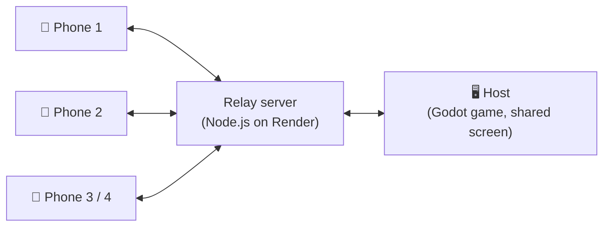
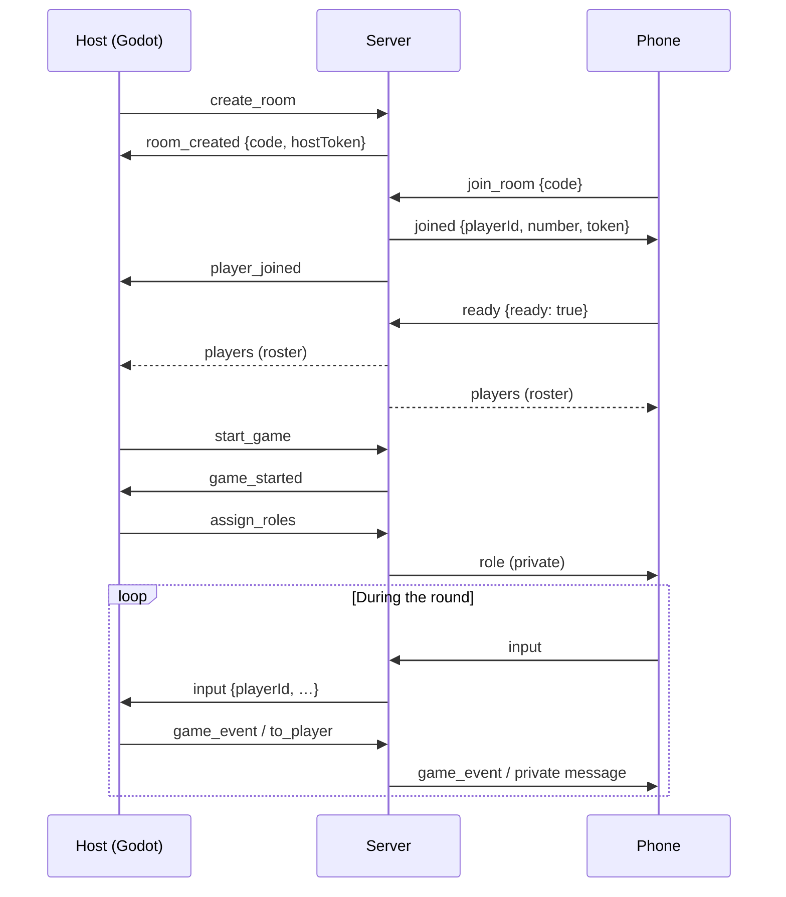

# Network

How the game, the server and the phones talk to each other. If you're adding something that
sends or receives messages, start here. The code this describes is `server/index.js` (the
server), `server/public/` (the phone page) and `game/scripts/network_manager.gd` (Godot).

**Contents:** [Architecture](#architecture) · [Message Protocol](#message-protocol) ·
[Room Lifecycle](#room-lifecycle) · [Local Testing](#local-testing) · [Deployment](#deployment)

## Architecture

PandeMOOnium is played like a party game: everyone looks at one shared screen (the **host**,
the Godot game) and uses their own phone as a controller. Phones open a web page, so nobody
installs anything.



| Piece | What it does | Code |
|---|---|---|
| **Host** (Godot) | Runs the actual game: movement, stations, customers, roles, win/lose. Everyone watches its screen. | `game/` |
| **Relay server** (Node.js) | Creates rooms, lets phones join, and **passes messages** between phones and the host. Also serves the phone page. It doesn't run any gameplay. | `server/index.js` |
| **Phone controller** (web page) | Joystick + buttons. Sends what the player presses, shows their role and messages from the game. | `server/public/` |

Everything travels as small **JSON messages** over one **WebSocket** per device
(`wss://pandemoonium.onrender.com/ws` online, `ws://127.0.0.1:3000/ws` on your laptop).

### Why it's built this way
- **The host is in charge.** The server only forwards messages, and the game decides what
  they mean. Gameplay changes happen in Godot, and the server rarely needs to change.
- **It works on any network.** Phones and the host both connect *out* to the server, so it works
  on school Wi-Fi (which blocks devices from talking to each other directly) and on cellular.
- **The impostor stays secret.** Roles go privately to each phone and are never in shared
  messages. The server also ignores SABOTAGE from anyone who isn't the impostor.
- **Nothing to install.** A browser is enough on phones and (with the itch.io build) on the host.

### Godot side
`network_manager.gd` is an autoload (`NetworkManager`) that only moves messages. It doesn't
know any game rules.
- `NetworkManager.connect_to_server(url)` connects and creates a room automatically.
- `NetworkManager.send_message({...})` sends a message to the server.
- Signal `message_received(message: Dictionary)` fires for every message from the server.
- Signal `disconnected()` fires when the connection is gone for good.
- `NetworkManager.leave()` disconnects on purpose (no retrying).

If the connection drops mid-game, it retries every 2 s for up to 30 s with `rejoin_room` (see
[Reconnecting](#reconnecting)). `lobby.gd` handles the lobby screens, and `main.gd` handles players,
input and the round.

## Message Protocol

Every message is a JSON object with a `type`. Messages that are malformed, sent at the wrong
time (for example, `input` while still in the lobby) or sent by the wrong device are **ignored**
unless an error is listed below.

### Host → server
| Message | When | What happens |
|---|---|---|
| `{"type":"create_room"}` | Once, right after connecting | Server makes a room and replies `room_created`. |
| `{"type":"rejoin_room","code":"A1B2C3","hostToken":"…"}` | After a dropped connection | Takes the room back (within 30 s). Replies `room_rejoined`, or error `Cannot rejoin room`. |
| `{"type":"start_game"}` | Lobby, when everyone is ready | Needs 2–4 players, all connected and ready. Replies `game_started`. |
| `{"type":"assign_roles","roles":{"<playerId>":"impostor","<playerId>":"barista"}}` | Playing | Each phone privately gets its own `role`. Anyone not listed as `impostor` becomes `barista`. |
| `{"type":"game_event","event":"P2 served a drink! +1"}` | Playing | Sent to every phone in the room (cut to 80 characters). |
| `{"type":"to_player","playerId":"<id>","msg":{"type":"anything", …}}` | Any time | Delivers `msg` to **one** phone, unchanged. `msg` must be an object with a `type`. Use it for private info (impostor hints, a player's own order, meeting screens) **without changing the server**. |

### Server → host
| Message | When |
|---|---|
| `{"type":"room_created","code":"A1B2C3","hostToken":"<48 hex chars>"}` | Room is ready. Show `code` on screen. Keep `hostToken` secret (it's the key to rejoin). |
| `{"type":"room_rejoined","code":"A1B2C3","phase":"lobby" \| "playing"}` | `rejoin_room` worked. |
| `{"type":"player_joined","playerId":"<id>","number":1,"name":"Player 1","ready":false}` | A phone joined or came back. Also re-sent for every connected phone after the host rejoins. |
| `{"type":"player_left","playerId":"<id>"}` | A phone disconnected or left. Its slot is held for 30 s if it just dropped. |
| `{"type":"players","players":[{"id":"<id>","number":1,"name":"Player 1","ready":true,"connected":true}],"phase":"lobby"}` | The roster changed. Also sent to phones. **Note:** the field is `id` here, but `playerId` everywhere else. Never contains roles. |
| `{"type":"game_started"}` | `start_game` was accepted. |
| `{"type":"input","playerId":"<id>","x":0.71,"y":-0.71,"action":true,"sabotage":false}` | A phone's controls. `x`/`y` are the joystick (−1 to 1, length never over 1). `action` = INTERACT held. `sabotage` is always `false` unless that player is the impostor. |
| `{"type":"call_meeting","playerId":"<id>"}` | A phone pressed the emergency meeting button (playing only). |
| `{"type":"vote","playerId":"<id>","target":"<playerId>" \| null}` | A phone voted. `target` is always a player in the room, or `null` = skip. The game decides whether the vote counts. |
| `{"type":"error","message":"…"}` | See [Errors](#errors). |

### Phone → server
| Message | When | What happens |
|---|---|---|
| `{"type":"join_room","code":"A1B2C3","token":"…"}` | After connecting | `token` is optional. If it matches a player in that room, the phone gets its old slot back. Code is case-insensitive. |
| `{"type":"ready","ready":true}` | Lobby | Toggles ready. Everyone gets a new `players`. |
| `{"type":"input","x":0.5,"y":0,"action":false,"sabotage":false}` | Playing | The phone page sends this the moment anything changes, plus every 100 ms. |
| `{"type":"call_meeting"}` | Playing | Forwarded to the host. |
| `{"type":"vote","target":"<playerId>" \| null}` | Playing | Forwarded to the host. |
| `{"type":"leave_room"}` | Any time | Leaves for good (slot freed right away). Replies `left_room`. |

> The current phone page doesn't have meeting/vote buttons yet. The server already supports
> them (#22, #24).

### Server → phone
| Message | When |
|---|---|
| `{"type":"joined","code":"A1B2C3","playerId":"<id>","number":2,"token":"<48 hex chars>","phase":"lobby","role":null,"hostConnected":true}` | Join worked. Save `token` to rejoin later. `role` is filled in when rejoining mid-game. |
| `{"type":"players", …}` | Same roster message the host gets (above). |
| `{"type":"role","role":"impostor" \| "barista"}` | Private: only this phone gets it. |
| `{"type":"game_event","event":"…"}` | Announcement from the game. |
| `{"type":"host_disconnected"}` | The host dropped. Room is kept for 30 s. |
| `{"type":"host_reconnected"}` | The host is back. |
| `{"type":"room_closed"}` | The room is gone (host didn't come back in time). |
| `{"type":"left_room"}` | Reply to `leave_room`. |
| anything sent with `to_player` | Whatever the host put in `msg`. The phone page ignores types it doesn't know. |
| `{"type":"error","message":"…"}` | See [Errors](#errors). |

### Errors
The phone pages (`controller.js`, and `controller-v2.js` if merged) check some of these strings
**exactly** to show the right screen, so if you change one, update them too.

| `message` | Cause |
|---|---|
| `Room not found` | No room with that code (wrong code, or it closed). |
| `Room full (4 players)` | Already 4 players. |
| `Round started. Only reconnecting players can join.` | New phones can't join once the round starts (rejoining with a token still works). |
| `Need 2–4 connected, ready players` | `start_game` too early. (The dash is an en dash `–`.) |
| `Cannot rejoin room` | `rejoin_room` with an unknown room or wrong `hostToken`. |
| `Already in a room` | This connection already created/joined a room. |
| `Join or create a room first` | Sent a room message before joining. |
| `Invalid message` / `Invalid JSON` | Not a JSON object. |

### Limits
| Limit | Value |
|---|---|
| Players per room | 2–4 (to start); max 4 |
| Room code | 6 characters, `0-9` and `A-F` (about 16 million codes) |
| Message size | 2 KB max (bigger messages close the connection) |
| Joystick updates | At most one every 12 ms per phone (extras are skipped). **Button changes are never skipped.** |
| Meeting / vote | Presses less than 250 ms apart are ignored (no mashing) |
| `game_event` text | 80 characters |
| Dead connections | The server pings every 15 s and drops connections that stop answering. That counts as a disconnect, so the slot is held. |

### Adding a new message
- **Host → one phone, or host → all phones:** use `to_player` (loop over players for "all"). No
  server change needed. Add a handler for the new `type` in `server/public/controller.js`.
- **Phone → host:** needs a small server change. Add a branch next to `call_meeting` / `vote`
  in `server/index.js` that checks the phase and forwards to `room.host` with the `playerId`.
  Add a test in `server/test/` and document it here.

## Room Lifecycle



1. **Create.** Host connects and sends `create_room`. The room starts in the `lobby` phase.
2. **Join.** Phones enter the code. Each gets the lowest free number (1–4) and a secret `token`.
3. **Ready.** Players tap Ready, and everyone sees the roster (`players`).
4. **Start.** With 2–4 connected, ready players, the host sends `start_game`, and the phase becomes
   `playing`. From now on only players with a token can (re)join.
5. **Roles.** The host picks the impostor and sends `assign_roles`. Each phone gets only its own role.
6. **Play.** Phones send `input`. The host sends `game_event`s and private messages.
7. **Close.** The room ends when the host disconnects and doesn't come back within 30 s. Phones
   get `room_closed`. (The server can't tell closing the game from a Wi-Fi drop, so it always
   waits the 30 s.)

> There's no "round over" message yet. After a round, the room stays in `playing`, so starting
> another round means creating a new room.

### Reconnecting
| Who drops | What happens |
|---|---|
| **A phone** (signal lost, Safari closed) | The host gets `player_left`. The slot is held for **30 s**. The phone page saves its token in `localStorage` (`pandemoonium:<CODE>`, last code in `pandemoonium:last`), so reopening the page pre-fills the code and rejoining with the token returns **the same player, number and role**. If the server still thinks the old connection is alive (common on iPhones), the token proves it's the same player and the new connection replaces the old one. |
| **A phone, on purpose** (Leave button) | `leave_room`: slot freed right away, token forgotten. |
| **The host** (laptop Wi-Fi blip) | Phones get `host_disconnected` and show a 30 s countdown. Godot retries every 2 s with `rejoin_room` + `hostToken`. If it's back in time: `room_rejoined`, every connected phone is re-announced with `player_joined`, and phones get `host_reconnected`. If not: `room_closed`. |
| **The server restarts** | All rooms are lost (they only live in memory), and everyone has to create a new room. This happens on every deploy (see [Deployment](#deployment)). |

## Local Testing

You only need this when changing `server/`. For playing and testing the game, the online server
works everywhere, even from the Godot editor.

**1. Run the server on your laptop** (first time: `npm install`)
```bash
cd server
npm install
npm start          # → http://localhost:3000
```
Optional: `HOST_RECONNECT_MS=5000 npm start` shortens the host's 30 s grace period to 5 s for testing.

**2. Point Godot at it.** Run the game, open **Advanced** in the lobby, set the server to
`ws://127.0.0.1:3000/ws`, then **Create Room**.

**3. Join as players**
- On the same laptop: open `http://localhost:3000` in a browser. For a **second player use a
  private/incognito window.** Normal tabs share `localStorage`, so a second tab rejoins as the
  same player.
- On a real phone: same Wi-Fi as the laptop, open `http://<laptop-IP>:3000` (the lobby shows the
  link). **School/campus Wi-Fi blocks this.** Use a phone hotspot, or test on the online server
  after merging.

**4. Run the tests** (they start their own server, no `npm start` needed)
```bash
cd server && npm test
```
Godot's customer tests (from the repo root, with the path to your Godot app):
```bash
godot --headless --path game -s res://tests/test_customers.gd
```

**Debugging tip:** in a desktop browser, open dev tools → Network → `ws` → Messages to watch
every message the phone page sends and receives.

## Deployment

### Server + phone page: Render
| Setting | Value |
|---|---|
| URL | **https://pandemoonium.onrender.com** (phones go here) · WebSocket `wss://pandemoonium.onrender.com/ws` |
| Plan | Free web service (Oregon, US West) |
| Source | `main` branch, root directory `server/`, build `npm install`, start `npm start` |
| Environment | `PORT` is set by Render. Optional `HOST_RECONNECT_MS` (default 30000). |

What to know:
- **It deploys itself.** Every merge to `main` goes live in about 1–2 minutes, including phone page
  changes. Pages are served with `Cache-Control: no-store`, so a refresh always gets the newest
  version.
- **A deploy restarts the server and closes every open room.** Don't merge during a playtest or demo.
- **It sleeps after 15 minutes with no traffic.** The next visit takes about 30–60 s to wake it up, and
  after that it's fast. During a round, phones send input constantly, so it doesn't sleep mid-game.
  Open the phone page a minute before a demo to wake it.
- **Speed (measured on the live server):** a button press takes about 30–35 ms from phone to game,
  even with 10 rooms playing at once.

### Game: itch.io
The Godot web build is uploaded **by hand**. Merging doesn't update it.
1. In Godot: **Project → Export → Web** (threads off), export to `build/web/` (git-ignored).
2. Zip the **contents** of `build/web/` (so `index.html` is at the top of the zip).
3. On itch.io: **Edit game → Uploads**, replace the old zip, tick **"This file will be played
   in the browser"**, and save.

The web build connects to the online server by default. The page is password-protected during
development. Ask the team for access (it's not written here on purpose).

### Where secrets go
Nothing secret belongs in this repo. Passwords and logins stay with the team, and any future server keys
go in Render's **Environment** settings, never in a file.
